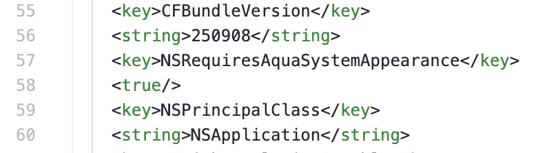

用 mac 打 pwn 也是快一年了，最近又想把深色的 ida 主题改成浅色（之前在 Windows 上用惯了），所以研究了一下怎么在保持系统为深色模式的前提下强制 ida 浅色。
（我也是想不通 ida 的脑回路，给了三个主题选项，跟随系统、深色、黑色，就是没有浅色，辣鸡！

## 工具准备

首先肯定是要安装好 ida 啦，然后的话随便有个文本编辑器，或者命令行 nano/vim 的也行，喜欢什么用什么。

## 修改方法

众所周知，在 macOS 上，通常用 .plist 文件来存储用户定义的系统首选项，也有很多 Apple 应用程序使用 .plist 文件来存储默认和当前设置，ida 也不例外。ida 的 .plist 文件路径为 `/Applications/IDA Professional 9.2.app/Contents/Info.plist`，直接用文本编辑器打开，可以看到许多默认配置，我们只要将下面两行插入进去即可：

```plist
    <key>NSRequiresAquaSystemAppearance</key>
    <true/>
```

效果如图：



（其实你看哪里顺眼插进去就行了，不用非和我一样

然后重新打开 ida，就会发现你的 ida 保持了浅色主题，不会再跟随系统主题颜色变化了。

## 总结

通过修改 ida 的 .plist 文件，可以在 macOS 上强制 ida 使用浅色主题，而不受系统主题颜色的影响。这种方法最新的 ida 9.2 版本也支持，低版本同理。
